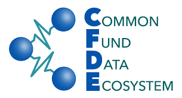

# DrugCentral DRS API 

A RESTful API providing access to the DrugCentral database with support for JSON, CSV, and TSV export formats.

> **Version 2 (this repository)** serves DrugCentral **dbversion 56 (2026-09-02)** at
> **https://api.drugcentral.org** (interactive docs: https://api.drugcentral.org/docs).
> It replaced v1 on 2026-11-19; v1's address, https://uxn2ycvimg.us-east-2.awsapprunner.com,
> now serves the same v2 API. A test deployment runs at https://chiltepin.health.unm.edu/drs/.

## Overview

The DrugCentral DRS (Data Repository Service) API provides programmatic access to comprehensive drug information from the DrugCentral database. This API enables researchers, developers, and data scientists to query drug structures, activities, targets, products, synonyms, adverse events, and predicted drug properties through a standardized REST interface.

## What's new in v2

- **Built for dbversion 56:** models and tests match DrugCentral dbversion 56, which adds 121 drugs since dbversion 54.
- **`pk_az` endpoints:** predicted pharmacokinetic, toxicological and safety properties from AstraZeneca's models ([details](#pk_az-predicted-properties)).
- **`/health` endpoint:** checks the database and reports the data version.
- **`/dbversion` endpoint:** the DrugCentral release the API serves, with its date.
- **Read-only database sessions:** every database session is read-only, so the API cannot change data even if its login could.
- **Clear errors when the database has problems:** `503` when it is unreachable or busy, `504` when a query runs longer than 30 seconds, instead of requests hanging.
- **Exact identifier matching:** identifiers such as InChIKeys and UniProt accessions match exactly (case-insensitive) instead of as substrings ([matching rules](#matching-rules)).
- **Stable ordering:** every list, export and lookup is sorted by the table's primary key, so `skip`/`limit` pages are repeatable.

## Quick Start

In the examples, `$API` is the base URL: `https://api.drugcentral.org`, or e.g. `http://127.0.0.1:8000` when [running locally](#running-locally).

### Check API and database status

```bash
curl $API/          # {"status":"ok"}  - the API process is up
curl $API/health    # {"status":"ok","database":"ok","dbversion":56} - 503 if the database is unreachable
curl $API/dbversion # {"version":56,"dtime":"2026-09-02T00:55:33.731000"}
```

### Get data in JSON format

```bash
curl "$API/structures?limit=5"                                  # first 5 structures
curl "$API/structures/inchikey/LIOLIMKSCNQPLV-UHFFFAOYSA-N"     # capmatinib by InChIKey
curl "$API/act_table_full/struct_id/5392"                       # capmatinib's bioactivities
curl "$API/pk_az/struct_id/4"                                   # all predicted properties of one drug
```

### Export CSV / TSV

```bash
curl "$API/structures/csv?limit=100" -o structures.csv
curl "$API/pk_az/type/herg/tsv" -o herg_predictions.tsv
```

## Available Endpoints

The complete, interactive list is at `$API/docs` (OpenAPI schema at `$API/openapi.json`).

| Pattern | Description |
|---|---|
| `/` | API process status (does not touch the database) |
| `/health` | Database status and data version |
| `/dbversion` | The DrugCentral release served: version and date |
| `/{table}?skip=0&limit=10` | Rows of a table, ordered by primary key |
| `/{table}/{column}/{value}` | Rows where a column matches a value ([matching rules](#matching-rules)); 404 if none |
| `/{table}/csv`, `/{table}/tsv` | Export rows as CSV/TSV (`skip`/`limit`, default limit 1000) |
| `/{table}/{column}/{value}/csv`, `.../tsv` | Export a lookup's results (FAERS and pk_az tables) |

**Tables:** `act_table_full`, `structures`, `identifier`, `id_type`, `synonyms`, `target_class`, `target_component`, `target_dictionary`, `target_go`, `target_keyword`, `td2tc`, `tdgo2tc`, `tdkey2tc`, `omop_relationship`, `product`, `struct2obprod`, `atc`, `struct2atc`, `drug_class`, `faers`, `faers_female`, `faers_male`, `pk_az`.

**CSV/TSV exports:** `act_table_full`, `structures` (without the multi-line `molfile`), `synonyms`, `target_component`, `product`, `faers`, `faers_female`, `faers_male`, `pk_az`.

### pk_az: predicted properties

Predicted pharmacokinetic, toxicological, and safety properties for drugs, from predictive models developed and released by researchers at AstraZeneca. **Values are model predictions, not measurements.** There are 25 property types, e.g. `herg`, `hppb`, `solubility-dd`, `kinase-safety-class`.

| Endpoint | Returns |
|---|---|
| `/pk_az/struct_id/{id}` | All predictions for one drug |
| `/pk_az/type/{type}` | One property type for all drugs (exact, case-insensitive) |

| Column | Meaning |
|---|---|
| `struct_id` | Drug identifier (`structures.id`) |
| `type` | Property type |
| `value` | Predicted value; for the kinase safety/selectivity classes, the number of predicted kinase hits; for `pfas-class`, 1 = PFAS structural alert |
| `unit` | Unit of the property, or `null`. For some types (`mh-clint`, `mppb`) the unit is missing in the source data rather than the property being unitless |
| `description` | Description of the property; for the kinase classes, the predicted kinases |
| `similarity` | Tanimoto similarity to the nearest compound in the model training set |
| `confidence` | `Moderate` (similarity 0.65–0.79) or `High` (0.8–1.0). With `similarity`, it is `null` only for `kinase-safety-class`, `kinase-selectivity-class` and `pfas-class`; `pld-class` has both, despite its name |

## Matching rules

| Lookup | Rule |
|---|---|
| `/structures/inchikey`, `/target_component/accession` and `/swissprot`, `/omop_relationship/umls_cui`, `/target_go/id`, `/tdgo2tc/go_id`, `/target_keyword/id`, `/tdkey2tc/tdkey_id`, `/pk_az/type` | Exact, case-insensitive |
| `/identifier/identifier` | Exact, ignoring case and surrounding spaces |
| `/product/ndc_product_code` | Exact |
| `/atc/code`, `/struct2atc/atc_code` | Prefix: a full code (`N02BE01`) is exact; a shorter code (`N02B`) returns that ATC group |
| `/act_table_full/accession` and `/swissprot` | Exact match on any entry of the pipe-separated list (`P02919` matches `P02918\|P02919\|...`) |
| Numeric columns (`/.../id/`, `/.../struct_id/`, ...) | Exact |
| Names and free text (`/structures/name`, `/synonyms/name`, `/faers/meddra_name`, ...) | Case-insensitive substring |

In substring searches, `%` and `_` are matched as ordinary characters, not as SQL wildcards.

**Known limitation:** a value containing a forward slash (for example the gene `UNQ5815/PRO19632`) cannot be looked up, because it splits the URL path. Use a different column, such as an id, for those rows.

## Query Parameters

List and export endpoints support pagination:

- `skip` - Number of records to skip (default: 0)
- `limit` - Maximum number of records to return (JSON default 10, CSV/TSV default 1000)

Rows are ordered by the table's primary key, so consecutive pages never overlap or skip rows.

`skip` must be between 0 and 100,000,000 and `limit` between 0 and 1,000,000; anything else, including negative or non-numeric values, returns `422`. The maximum limit is larger than the biggest table, so whole-table exports are unaffected.

```bash
curl "$API/structures?skip=100&limit=100"                       # records 100-199
curl "$API/structures/csv?limit=5000" -o structures.csv          # first 5000 structures
```

## CSV/TSV Export Feature

- **Streaming**: rows are written to the response as they are formatted
- **Automatic timestamps**: file names include a timestamp (e.g. `drugcentral_structures_20260915_143022.csv`)
- **Download headers**: `Content-Type` and `Content-Disposition` are set for browser downloads
- **Type handling**: datetimes in ISO format, NULL as empty, numbers unquoted, text quoted (safe for SMILES/InChI)

## Errors

| Status | Meaning |
|---|---|
| `404` | No rows match the lookup |
| `422` | Invalid parameter: wrong type, out of range, or a NUL character in the path |
| `503` | Database unreachable, or all database connections are busy |
| `504` | The query ran longer than 30 seconds |

## Running Locally

For a step-by-step walkthrough, including example requests, tests and troubleshooting, see
[GETTING_STARTED.md](GETTING_STARTED.md). In short:

1. Install dependencies (Python 3.11+):
   ```bash
   python -m venv venv
   venv/bin/pip install -r requirements-dev.txt
   ```
2. Get a database. With Docker, restore the DrugCentral dataset dump into a local container (about 15 minutes):
   ```bash
   scripts/restore_local_db.sh path/to/Drugcentral_2026-09-25.pgdump
   ```
   This starts PostgreSQL 16 + RDKit on `127.0.0.1:5435`, adds the API's indexes (`db/indexes.sql`), creates a read-only user (`db/api_readonly_role.sql`) and writes `DATABASE_URL` to `.env`. To use another DrugCentral database instead, copy `.env.example` to `.env` and set `DATABASE_URL`.
3. Start the API:
   ```bash
   venv/bin/uvicorn app.main:app --env-file .env
   ```
   Interactive docs: http://127.0.0.1:8000/docs

## Tests

Integration tests run against the database in `DATABASE_URL` (DrugCentral dbversion 56 or newer):

```bash
venv/bin/pytest
```

To call every endpoint several times against a running server and get a per-endpoint report:

```bash
venv/bin/python scripts/check_endpoints.py --base http://127.0.0.1:8000 --repeat 5
```

## Deployment

See [DEPLOYMENT.md](DEPLOYMENT.md).

## Developer Information
- Manjil Pradhan, BSc (University of New Mexico)
- Praveen Kumar, PhD (University of New Mexico)
- Jeremy Yang, PhD (University of New Mexico)

## Project Context

This API is part of the Illuminating the Druggable Genome (IDG) Data Coordinating Center (DCC) initiative, which develops tools and workflows for integration, harmonization, and FAIRification of IDG resources within the Common Fund Data Ecosystem (CFDE).

---

## Original Documentation

# CFDE_DRS_API 

The Illuminating the Druggable Genome (IDG) Data Coordinating Center
(DCC) develops code, tools, and workflows for integration, harmonization
and FAIRification of IDG resources for access and interoperability
in the Common Fund Data Ecosystem (CFDE).

Lead developer for the DRS API components is Praveen Kumar, PhD, of UNM.

The CFDE IDG DCC team is led by PIs Christophe Lambert, PhD, and Jeremy
Yang, PhD, of UNM.

## Data Repository Service (DRS) API

The Data Repository Service (DRS) API provides a generic interface to data repositories so data consumers, including workflow systems, can access data in a single, standardized way regardless of where it's stored or how it's managed. The primary functionality of DRS is to map a logical ID to a means for physically retrieving the data represented by the ID.

## Cloud Workspace Integration and Interoperability

DRS APIs are designed for integration and interoperability with the
Galaxy cloud workspace system, and being developed in cooperation with
the CFDE Cloud Workspace Implementation Center (CWIC). Moreover, DRS and
other industry and community standards are being employed for interoperability
with CFDE centers and resources of the NIH Common Fund and beyond.
